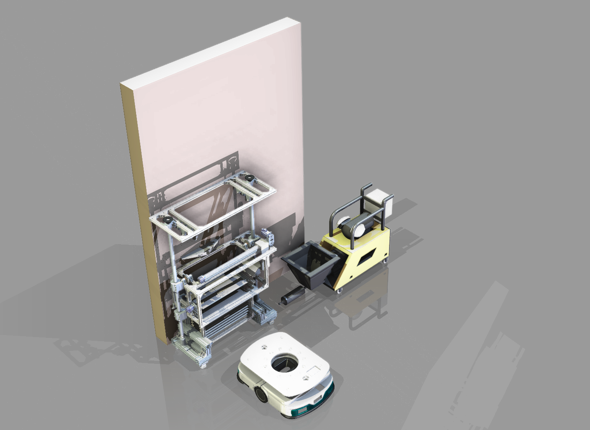

# 墙面瓷砖自动铺设装置

> 面向建筑行业劳动力短缺的瓷砖自动化铺设解决方案 —— 2025 项目

## 目录结构
- `Body/` -存放主要内容
- `Note`  -存放零时想法

## 使用方法（包括INDEX）
### 效果图

*中沙拉售卖机 - 实物渲染效果*

### 项目简介
本项目针对当前建筑行业**瓷砖铺设工人短缺、人工效率低、质量不稳定**等问题，设计了一款**墙面瓷砖自动铺设装置**。通过机械结构创新，实现瓷砖的自动抓取、翻转、涂胶、精准铺贴和接缝控制，大幅提升施工效率和铺贴质量，减少人工依赖和职业伤害。
**设计者**：金家俊、陈煜暄、张航程、王齐权、张晋玮  
**所属课程**：机械设计 / 创新实践  
**完成日期**：2025 年

### 主要功能
- **自动抓取**：无动力可回弹夹爪，适应 600×300mm 常见规格瓷砖
- **自动翻转**：四连杆机构实现瓷砖从水平到竖直的平稳翻转
- **自动涂胶**：均匀涂抹粘结剂，厚度误差 ±0.5mm
- **精准铺贴**：垂直定位精度 ±0.5mm，支持多种接缝宽度（1-5mm）
- **轻拿轻放**：铺贴速度控制，避免瓷砖破裂

### 创新特色
- 斜面导向 + 弹簧回位抓取机构（结构简单、无需额外动力）
- 四连杆翻转机构（速度和加速度优化，实现轻拿轻放）
- 自动涂胶与接缝控制系统
- 可扩展至外墙板件、幕墙玻璃安装
---
### 项目文件索引

- **[设计说明书](./5-Office/墙面瓷砖铺设装置设计说明书.docx)**
- **核心技术**：
  - 瓷砖抓取与翻转机构
  - 自动涂胶系统
  - 铺贴速度与加速度控制
  - 接缝精度控制

### 应用前景

- 显著提升建筑施工效率，缓解熟练工人短缺问题
- 减少人工劳动强度，提高铺贴质量一致性
- 可扩展应用于外墙干挂、幕墙安装等领域
- 具备良好的工程实用价值和商业化潜力

---
## 保留内容

### 学习许可与权利保留

- 本项目允许个人、学校和研究者进行非商业性的学习、研究和引用。
- 未经著作权人书面许可，不得将项目内容用于商业开发、产品制造、商业服务、商业宣传、投标交付、毕业设计成品交付或再授权。
- 不得删除作者、来源、版本历史和第三方许可证声明，不得将本项目或其衍生成果宣称为与作者无关的原创项目。
- 软件源码适用 [PolyForm Noncommercial 1.0.0](https://polyformproject.org/licenses/noncommercial/1.0.0/)；机械模型、PCB、原理图、图片、文档、Unity 工程和其他非软件资料适用 [CC BY-NC-ND 4.0](https://creativecommons.org/licenses/by-nc-nd/4.0/)。
- SE、SW、STEP/STP 及其他三维模型仅允许个人或学校进行非商业学习、评审和研究；未经著作权人书面许可，不得用于加工、打样、制造、销售、量产、投标、产品交付、商业宣传、改作或再授权。
- 第三方组件、模板、元件库、外购件模型和工具仍受其原始许可证约束；本声明不扩大作者对第三方内容的权利。

商业使用、产品化、公司内部长期使用、转让或排他性授权需另行取得著作权人的书面许可。